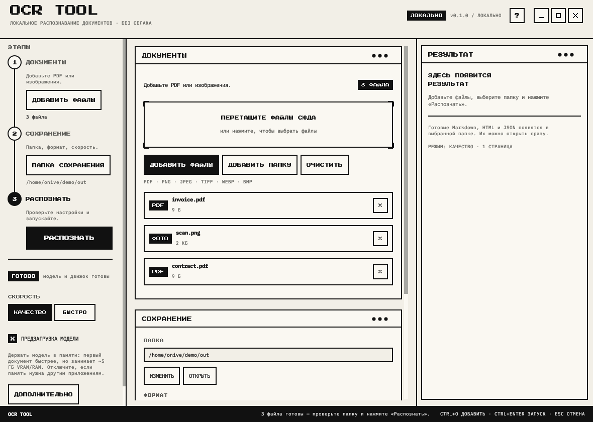

# ocr-tool

[](https://github.com/onive/ocr-tool/actions/workflows/ci.yml)
[](https://github.com/onive/ocr-tool/releases)
[](LICENSE)

[English](README.md) · **Русский**

Локальное OCR для PDF и изображений (PNG/JPEG/TIFF/WebP/BMP) с упором на
русские документы. PDFium рендерит страницы, локальный `llama-server`
(llama.cpp) запускает Chandra OCR 2, результат сохраняется в Markdown,
самостоятельный HTML в UTF-8 и/или JSON с блоками и bbox. Есть CLI
(`ocr-tool`) и GUI (`ocr-tool-gui`).
После загрузки runtime и модели всё работает офлайн.



Больше экранов: [docs/screenshots/pixel-ui](docs/screenshots/pixel-ui/)
(подготовка, распознавание, результат, ошибка, дополнительные настройки,
справка и минимальный размер 1000×720).

> **Это не один exe.** Нужны: бинарник `ocr-tool` + библиотека PDFium +
> `llama-server` + файлы модели (~3,4 ГБ). Веса модели никогда не входят в
> поставку; во время распознавания сеть не используется.

## Статус

Версия **0.1.0**. Локально собрано и проверено на **Windows 11 x64**, Rust 1.99
MSVC, RTX 3060 12 ГБ (Vulkan), llama.cpp **b12535**, PDFium **chromium/8165**,
Chandra OCR 2 **Q4_K_M** + **mmproj Q8_0**. **200** тестов workspace проходят
на Windows; Linux/macOS проверяются в CI-матрице (`.github/workflows/ci.yml`),
а не на локальном железе. Релизные архивы **без подписи кода** (нет
Authenticode, notarization и установщика).

| Компонент | Закреплённая версия |
|---|---|
| llama.cpp | b12535 |
| PDFium (pdfium-binaries) | chromium/8165 (PDFium 160.0.8165.0) |
| Модель | `mradermacher/chandra-ocr-2-GGUF` Q4_K_M 3,07 ГБ + mmproj Q8_0 367 МБ |
| Rust | 1.82+ (проверено на 1.99) |

## Быстрый старт (Windows)

1. Скачайте `ocr-tool-0.1.0-windows-x64.zip` из
   [Releases](https://github.com/onive/ocr-tool/releases).
2. Распакуйте в любую папку — установщика нет, права администратора не нужны.
3. Запустите `ocr-tool-gui.exe`.

При первом запуске GUI скачивает закреплённую модель (~3,4 ГБ). Релизный архив
уже содержит `runtime/`; движок GUI скачивает, только если его нет — например,
при сборке из исходников или после удаления папки (~70 МБ: `llama-server` +
PDFium). После этого распознавание идёт локально, CLI и сеть не нужны.

Сборка из исходников:

```powershell
git clone https://github.com/onive/ocr-tool.git
cd ocr-tool
cargo build --release
.\target\release\ocr-tool-gui.exe
```

Публичный репозиторий **не содержит тестовых документов**. `samples/SOURCES.md`
описывает только происхождение локальных фикстур; сами файлы содержат
персональные данные и не публикуются. Используйте свой файл, например
`C:\docs\document.pdf` (Windows) или `path/to/document.pdf` (Linux/macOS).

При первом запуске GUI показывает панель **ПОДГОТОВКА** с двумя независимыми
строками:

1. **СКАЧАТЬ МОДЕЛЬ (~3,4 ГБ)** — закреплённая пара Chandra Q4_K_M + mmproj,
   с докачкой и проверкой SHA-256, в app-data (или папку, выбранную через
   **ПАПКА МОДЕЛИ**).
2. **СКАЧАТЬ ДВИЖОК (~70 МБ)** — llama-vulkan, llama-cpu и PDFium в
   редактируемую папку движка (по умолчанию
   `%LOCALAPPDATA%\ocr-tool\runtime\windows-x64`; на macOS ~25 МБ).

У обеих загрузок есть прогресс и отмена; пока идёт любая, **РАСПОЗНАТЬ** и
вторая кнопка недоступны. Чтобы держать всё в одном месте, выберите обе папки
внутри общей родительской через **ПАПКА МОДЕЛИ** / **ПАПКА ДВИЖКА**.

В Windows release GUI собран как Windows-subsystem приложение: двойной клик по
`ocr-tool-gui.exe` открывает только окно GUI, без отдельной консоли. Старт,
ошибки preflight/загрузок и паники (с backtrace) дописываются в
`%LOCALAPPDATA%\ocr-tool\logs\gui.log`
(`<app-data>/ocr-tool/logs/gui.log` в Linux/macOS) и остаются в логе окна;
debug-сборка сохраняет консоль для логов. `ocr-tool.exe` остаётся консольной
программой. Загрузки модели/runtime идут в фоновых потоках, а `llama-server` —
отдельный скрытый sidecar под управлением GUI (in-process inference вне рамок).

Оба Windows-exe несут одну и ту же pixel-art иконку (`assets/ocr-tool.ico`,
размеры 16–256): её показывают Explorer, панель задач и Alt-Tab; иконка окна
GUI берётся из `assets/icon-256.png`. Палитра — cream `#F2EFE7` и ink
`#111111`, рисунок — документ с scan-линией. Редактируемый SVG-исходник —
`assets/ocr-tool.svg`; ICO/PNG пересобираются командой
`bun scripts/gen-icon.ts`. Превью:
[docs/screenshots/pixel-ui/icon-preview.png](docs/screenshots/pixel-ui/icon-preview.png).
PNG также используется для иконок окна в Linux/macOS; `.icns` для macOS при
необходимости генерируется в CI из того же исходника.

CLI-паритет (для роботов/скриптов):

```powershell
cargo run --release -p ocr-cli -- runtime download
cargo run --release -p ocr-cli -- models download
cargo run --release -p ocr-cli -- doctor
cargo run --release -p ocr-cli -- ocr C:\docs\document.pdf -o out
cargo run --release -p ocr-cli -- ocr C:\docs\contract.pdf -o out --pages 1-2
```

GUI самодостаточен: если модели нет, он предлагает **СКАЧАТЬ МОДЕЛЬ
(~3,4 ГБ)** (прогресс, отмена, докачка `.part`; уже лежащие файлы, в том числе
`chandra-q4.gguf` + `mmproj.gguf`, не перекачиваются) и **ПАПКА МОДЕЛИ**. Если
нет движка — папку движка и **СКАЧАТЬ ДВИЖОК**. Обе загрузки продолжаются с
`.part` и узнают уже установленные компоненты, поэтому ничего не качается
дважды. Если файлы модели есть, но неверного размера, **ЗАМЕНИТЬ** (с
подтверждением) удаляет их и заново скачивает закреплённую пару; для готового
движка есть **ПЕРЕУСТАНОВИТЬ**.

Linux/macOS:

```bash
cargo build --release
cargo run --release -p ocr-cli -- runtime download
cargo run --release -p ocr-cli -- models download
cargo run --release -p ocr-cli -- doctor
cargo run --release -p ocr-cli -- ocr document.pdf -o out
```

Пути можно задать явно:

```powershell
$env:OCR_LLAMA_SERVER = "C:\tools\llama\llama-server.exe"
$env:OCR_MODEL_DIR    = "C:\models\chandra-ocr-2"
$env:OCR_PDFIUM       = "C:\tools\pdfium\pdfium.dll"
```

или флагами `--llama-dir`, `--model-dir`, `--pdfium`; в GUI — поля model dir,
llama dir, PDFium в разделе **ДОПОЛНИТЕЛЬНО**. Папка движка в панели подготовки
(и тот же выбор в **ДОПОЛНИТЕЛЬНО**) заполняет каталог llama-server и библиотеку
PDFium из `runtime/<os>-<arch>/{llama-*,pdfium}`; в эту же папку кнопка
**СКАЧАТЬ ДВИЖОК** ставит закреплённые архивы. Папки модели и runtime
независимы — задайте обе, если хотите держать всё вместе.

## CLI

```
ocr-tool ocr <inputs...> -o <dir>
    [--format md|html|json|both|all] [--extract-blocks none|images|all]
    [--device auto|gpu|cpu] [--dpi 192]
    [--pages 1-5,7] [--password PASS] [--model-dir PATH] [--llama-dir PATH]
    [--pdfium PATH] [--recursive] [--json]
    [--max-pixels N] [--max-tokens N] [--timeout SECONDS]
    [--fast | --image-max-tokens N] [--parallel-pages 1|2]

ocr-tool doctor [--model-dir PATH] [--llama-dir PATH] [--json]
ocr-tool models download [--dir PATH] [--force]
ocr-tool models verify [--dir PATH] [--deep]
ocr-tool runtime download [--dir PATH] [--force]
ocr-tool runtime verify [--dir PATH]
ocr-tool gui
```

- Вход — файлы и/или каталоги; каталоги сканируются на один уровень, с
  `--recursive` — рекурсивно.
- Номера страниц считаются с 1; диапазон обрезается по длине документа.
  Некорректный диапазон (включая `0`) отсекается на preflight с кодом `2`.
- `--password` открывает зашифрованные PDF; пароль передаётся только PDFium и
  не попадает в логи, `_meta.json` или лог GUI.
- Прогресс — в **stderr**, итог или JSON-отчёт — в **stdout**. Если выбрана
  часть страниц, печатается `page 9/11 (selected 1/3)`, а не `page 9/3`.
- Коды выхода: `0` успех, `2` ошибка аргументов/конфигурации (нет входа, модели,
  PDFium; несуществующий явный `--llama-dir` — предупреждение с откатом на
  найденный runtime), `3` ошибка обработки/отмена. Частичные ошибки страниц не
  прерывают документ, успешные результаты сохраняются, но код будет `3`.
- Ошибка одной страницы не прерывает остальные.
- `models verify` проверяет размеры закреплённых файлов без чтения весов;
  `--deep` дополнительно считает SHA-256 (читает ~3,4 ГБ). `models download`
  узнаёт те же переименованные пары, что и OCR (`chandra-q4.gguf` +
  `mmproj.gguf`), и не качает их повторно.
- `runtime download` ставит закреплённые сборки llama.cpp b12535
  (Vulkan/Metal GPU + CPU fallback) и PDFium 8165 в `--dir` (по умолчанию
  `%LOCALAPPDATA%\ocr-tool\runtime\<tag>`). Архивы проверяются по размеру и
  SHA-256 до распаковки, `.part` продолжается с места отмены, компонент
  распаковывается во временный каталог и переименовывается на место.
  `runtime verify` проверяет установленную папку офлайн и выходит с кодом `2`,
  если компонента нет; ошибка `runtime download` — код `3`. Обе команды
  принимают `--dir PATH`; модель и runtime ставятся независимо.

### Профили скорости

- **Качество (по умолчанию):** 4096 токенов изображения, страницы по одной.
  Лучшая точность таблиц и мелкого текста. На эталоне RTX 3060 CUDA измерено
  **19,65 с** на страницу A4.
- **Быстро:** `--fast` (то же, что `--image-max-tokens 2048`). Prefill картинки
  сокращается с 4,1 до 1,7 с, страница — с **19,65 до 16,53 с (−16%)**; в
  выборочной проверке на счёте ключевые поля сохранились. На других документах
  возможны отличия: на договоре из двух страниц быстрый профиль изменил строку
  с номером/датой приказа, поэтому для юридических и финансовых документов
  по умолчанию остаётся Качество. Ограничение: подписи строк таблиц
  (`БИК`, `Сч. №`) могут сместиться на строку вниз — проверяйте банковские
  реквизиты и таблицы перед автоматизацией. `--image-max-tokens N` принимает
  1–4096 для экспериментов; при одновременном указании побеждает `--fast`.
  Ограничение передаётся sidecar через `LLAMA_ARG_IMAGE_MAX_TOKENS`, поэтому
  работает и со сборками без одноимённого флага.
- **Две страницы одновременно:** `--parallel-pages 2` запускает `llama-server`
  с `-np 2 -c 20000` и распознаёт страницы PDF парами. На том же эталоне
  измерено **13,18 с/страница** при 4096 токенах и **10,22 с/страница** при
  2048 (две страницы за 20,4 с, ~5,1 ГБ VRAM): ускорение пакета в 1,5–1,9 раза.
  Одна страница быстрее не становится — один запрос занимает один слот; порядок
  страниц в результатах сохраняется. На CPU оба запроса делят одни ядра,
  ускорения может не быть. Изображения (не PDF) по-прежнему обрабатываются по
  одному.

Имена: `<stem>.md`, `<stem>.html`, `<stem>.json` (только запрошенные форматы);
при коллизии — `-2`, `-3`. `--format both` сохраняет прежнее поведение
(md+html), `all` — md+html+json, `json` — только JSON. Зарезервированные
имена Windows (`CON`, `NUL`, `COM1`, …) получают суффикс `_`. Для каждого
документа пишется `<stem>_meta.json`, для задания — `_meta.json`; параллельные
задания в одном `-o` объединяют документы под файловой блокировкой. Страницы PDF
разделяются `<!-- page N -->` в Markdown и `<section data-page="N">` в HTML.
HTML очищается ammonia, содержит `<meta charset="utf-8">` и `lang="ru"`.

### JSON, файлы блоков и встраивание

`<stem>.json` повторяет форму официального `_chunks.json` (bbox в пикселях
страницы, label, внутренний HTML) и добавляет заголовок, стабильные id блоков и
пути к файлам:

```json
{
  "schema": "chandra-json/v1",
  "source": "contract_ru.pdf",
  "generator": "ocr-tool",
  "pages": [{
    "page_num": 1,
    "page_box": [0, 0, 2480, 3508],
    "chunks": [{
      "block_id": "p1-01",
      "bbox": [100, 200, 2400, 500],
      "label": "Text",
      "content": "<p>…</p>",
      "text": "…",
      "assets": {"png": "contract_ru_blocks/page-1-01-text.png",
                 "md": "contract_ru_blocks/page-1-01-text.md"}
    }]
  }]
}
```

- Нормализованный `data-bbox` 0–1000 переводится в пиксели; `page_box` —
  `[0, 0, width, height]` JPEG, который видел модель (после DPI рендера PDF или
  уменьшения изображения).
- `content` — очищенный внутренний HTML блока; вложенные `data-bbox`/`data-label`
  удаляются. `text` — plain text (включая `img alt`).
- `block_id` — `p<страница>-<NN>`; его получает каждый top-level блок.
- Если layout-разметки нет, создаётся один блок `block` на всю страницу;
  `Blank-Page` пропускается.
- `assets` перечисляет только реально созданные файлы относительно JSON.
  Невалидный/крошечный bbox оставляет chunk в JSON, но PNG не создаётся.

`--extract-blocks` управляет файлами блоков (по умолчанию `none`):

| режим | файлы |
|---|---|
| `none` | файлов блоков нет; JSON с chunks/bbox/text всё равно пишется при `--format json\|all` |
| `images` | PNG только для `Image`/`Figure` (прежний `--extract-images`) |
| `all` | PNG каждого непустого блока + типизированные файлы ниже |

`--extract-images` сохранён как устаревший alias для `--extract-blocks images`.

Типизированные файлы для `all` пишутся в
`<stem>_blocks/page-<n>-<idx>-<label>.<ext>`:

| label | файлы |
|---|---|
| `Text`, `Section-Header`, `Caption`, `Footnote`, `List-Group`, `Table-Of-Contents`, `Bibliography`, `Page-Header`, `Page-Footer`, `Complex-Block` | `.md`, `.png` |
| `Table` | `.html` (HTML блока), `.csv` (развёрнутые строки), `.png` |
| `Equation-Block` | `.tex` (текст из `<math>`), `.png` |
| `Code-Block` | `.txt`, `.png` |
| `Form` | `.html` (inputs/checkboxes), `.png` |
| `Image`, `Figure`, `Diagram` | `.png`, `.txt` (alt/описание) |
| `Chemical-Block` | `.html`, `.txt` (SMILES/chem), `.png` |
| `Blank-Page` | пропускается |

CSV берёт первую top-level таблицу; `colspan`/`rowspan` разворачиваются пустыми
ячейками, поля экранируются по RFC 4180. Вложенные таблицы уплощаются
best-effort. PNG меньше 8×8 px или с невалидным bbox пропускается. После 2000
файлов на документ извлечение останавливается с предупреждением; JSON остаётся.

При включённом извлечении HTML/Markdown размечаются:
- HTML оборачивает каждый встроенный блок в
  `<section class="ocr-block" id="block-p1-01" data-block-id="p1-01" data-label="Text">`
  и добавляет компактные ссылки `<a class="ocr-asset">PNG</a>`;
  `Image`/`Figure`/`Diagram` получают настоящий ``.
- Markdown добавляет `<!-- block: p1-01 Text -->` и ссылки на assets;
  визуальные блоки — ``.
- `images` размечает только `Image`/`Figure`; `none` оставляет прежние
  Markdown/HTML без изменений.

Печати, логотипы и подписи извлекаются **только если Chandra разметила их как
`Image`/`Figure`**. Мелкая печать может оказаться `Text`/`Form`, а рукописная
подпись — текстом; гарантии нет. В режиме `all` PNG и типизированный файл
получает любой label, который выбрала модель. Список файлов пишется в
`<stem>_meta.json` (`images`, а также `assets` со всеми файлами).

## GUI

```powershell
cargo run --release -p ocr-gui
# или target\release\ocr-tool-gui.exe без аргументов
```

GUI самодостаточен при первом запуске — CLI и переменные окружения не нужны.

- **Русский pixel-art интерфейс.** Все видимые подписи русские (бренд и
  технические имена вроде `OCR TOOL`, `PDFium`, `DPI`, `HTML/JSON/MD`
  остаются как есть), палитра cream `#F2EFE7` / ink `#111111`, пиксельные
  шрифты. Скриншоты — в [галерее](docs/screenshots/pixel-ui/).
- **Frameless-окно с собственной шапкой.** Нативное оформление отключено,
  шапка заменяет title bar: за неё окно перетаскивается, двойной клик
  разворачивает/восстанавливает, края служат для resize, справа — кнопки
  `—` / `□` / `×`. Минимальный размер — **1000×720** (по умолчанию 1180×840);
  окно остаётся resizable, сохраняет иконку и видно на панели задач.
- **Без консольного окна** — release-бинарник использует Windows GUI subsystem,
  поэтому запуск из Explorer создаёт только окно приложения. Диагностика
  пишется в `%LOCALAPPDATA%\ocr-tool\logs\gui.log` (Linux/macOS:
  `<app-data>/ocr-tool/logs/gui.log`); при фатальной ошибке до появления окна
  открывается диалог с путём к логу. Debug-сборка сохраняет консоль.
- При старте и при каждом изменении путей выполняются дешёвые проверки (без
  запуска OCR): каталог модели резолвится и размеры двух GGUF сверяются с
  закреплёнными; PDFium ищется, кандидаты `llama-server` перечисляются.
- **Модели нет или она неполная** — панель **ПОДГОТОВКА** помечает модель
  `НЕТ` или `НЕПОЛНАЯ` и предлагает **СКАЧАТЬ МОДЕЛЬ (~3,4 ГБ)** (фоновый
  поток, байты/проценты по файлам, уже лежащие файлы пропускаются, отмена
  сохраняет `.part` для докачки), **ПАПКА МОДЕЛИ** (выбор сразу
  перепроверяется) и **ЗАМЕНИТЬ**. Замена спрашивает подтверждение, удаляет
  существующие файлы модели и их `.part` и заново скачивает закреплённую пару;
  это выход GUI из состояния «неполная / неверный размер», которое обычная
  загрузка намеренно не перезаписывает.
- **Нет движка** — та же панель показывает редактируемую папку движка
  (подсказка — платформенная папка по умолчанию), **ПАПКА ДВИЖКА** и
  **СКАЧАТЬ ДВИЖОК** (~70 МБ; на macOS ~25 МБ). Загрузка скачивает
  llama-vulkan, llama-cpu и PDFium для текущей платформы, сверяет закреплённый
  SHA-256 и ставит их в выбранную папку; видны прогресс, статус по компонентам
  и отмена, частичный `.part` продолжается. После успеха папка заполняет llama
  dir (`llama-vulkan` / `llama-cpu`) и PDFium (`pdfium/bin|lib/<lib>`), статус
  сообщает, что движок готов. В дистрибутиве папка `runtime` рядом с exe
  по-прежнему находится автоматически. Сырой `os error 3` в главный статус не
  попадает.
- **Независимые загрузки** — у модели и движка свои кнопки и отмена; пока идёт
  любая, **РАСПОЗНАТЬ** и вторая кнопка недоступны. **ПЕРЕУСТАНОВИТЬ** (с
  подтверждением) находится в строке движка, когда runtime уже готов.
- **Источник PDFium** — статус готовности показывает, откуда взята библиотека:
  выбранная папка runtime/путь, `OCR_PDFIUM` или автопоиск рядом с приложением.
  Если `OCR_PDFIUM` перекрывает встроенный runtime, выводится предупреждение.
- **ДОПОЛНИТЕЛЬНО** разворачивается автоматически, пока setup не завершён
  (нет модели, llama-server или PDFium); остаются опциональные поля model dir /
  llama dir / PDFium / папка движка (то же поле, что в панели подготовки).
- Распознавание: **ДОБАВИТЬ ФАЙЛЫ** (можно перетащить), папка сохранения,
  формат (`MD`, `HTML`, `JSON`, `ОБА`, `ВСЁ`), устройство, DPI, диапазон
  страниц, пароль PDF (скрытое поле), рекурсия и режим **Извлечение блоков**
  (выкл / только рисунки / все блоки). Карточка **СКОРОСТЬ** выбирает
  **КАЧЕСТВО** (4096 токенов изображения) или **БЫСТРО** (2048; примерно на 15%
  быстрее, строки таблиц могут сдвигаться) и включает **2 страницы одновременно
  (PDF; GPU)**. **РАСПОЗНАТЬ** запускает фоновый поток с прогрессом, статусом
  страниц, логом и отменой.
- **Кнопки результата** — **ОТКРЫТЬ ПАПКУ**, **ОТКРЫТЬ HTML**, **ОТКРЫТЬ MD**,
  **ОТКРЫТЬ JSON**; кнопка файла появляется только когда файл существует,
  поэтому **ОТКРЫТЬ MD** нет у задания только с HTML или JSON. Отмена убивает
  запрос и дерево процессов `llama-server`; закрытие окна отменяет задание и
  дожидается остановки sidecar.
- **Предзагрузка модели** (`preload_model`, **включена по умолчанию**) — после
  подготовки GUI запускает `llama-server` и держит модель в памяти, поэтому
  первый документ не тратит время на старт движка. Сервер переиспользуется
  между заданиями, статусы — `ЗАГРУЖАЕМ МОДЕЛЬ…` и `МОДЕЛЬ В ПАМЯТИ`; занято
  примерно **5 ГБ VRAM/RAM**. Отключается переключателем **ПРЕДЗАГРУЗКА
  МОДЕЛИ** в карточке **СКОРОСТЬ**, если память нужна другим приложениям;
  выбор запоминается. Ошибка предзагрузки не блокирует распознавание — следующее
  задание запустит свой движок.
- **Сохранённые настройки** — output/format/device/DPI/blocks/fast/parallel,
  `model_dir`, `runtime_dir`, `llama_dir`, `pdfium`, `pages`, `recursive`,
  `max_pixels`, `max_tokens`, таймаут запроса (`timeout_secs`) и
  `preload_model` хранятся в `gui-prefs.json` в app-data. Пароль, имена
  документов и их содержимое не сохраняются.
- **Примерное время до окончания с самого начала.** До первой готовой
  страницы GUI показывает намеренно осторожную оценку: ~12 мин на каждую
  выбранную страницу плюс ~20 с на запуск для CPU (Быстро: ~10 мин на
  страницу); ~30 с на страницу плюс ~10 с на запуск для GPU (Быстро: ~25 с).
  При двух страницах одновременно ETA считает пачки по две: пропускная
  способность растёт, а задержка одной страницы — нет. Auto следует найденному
  runtime: оценка GPU, если есть GPU-кандидат, иначе осторожная оценка CPU.
  После первых страниц оценка уточняется по фактическому
  среднему. Для нескольких файлов подпись явно говорит «по текущему файлу»;
  пока число страниц неизвестно, ETA не показывается. Это оценка, а не
  обещание точного времени.

## Как работает

```
input ─┬─ image ──────────────► JPEG (downscale to --max-pixels)
       └─ PDF → PDFium (DPI) ──► JPEG per selected page
                                     │
                         llama-server /v1/chat/completions
                         official Chandra ocr_layout prompt
                         temperature=0, max_tokens=4096
                                     │
                     HTML blocks ──► ammonia ──► .html
                              ├────► htmd ─────► .md
                              └────► layout ───► .json (+ _blocks/*.png|md|…)
```

- Один `llama-server` на задание, уникальный `--alias`, свободный локальный
  порт, health-check до 180 с, таймаут запроса 600 с, обязательный
  `--reasoning off`. Перед принятием сервера `/props` или `/v1/models`
  подтверждают alias/путь модели; при несовпадении порт перевыбирается.
  Sidecar всегда получает `-np 1` или `-np 2`; для двух слотов используется
  `-c 20000`, а лимит токенов изображения передаётся через
  `LLAMA_ARG_IMAGE_MAX_TOKENS`.
- Процесс убивается деревом (`taskkill /T /F`) и Windows Job Object с
  `KILL_ON_JOB_CLOSE`; на Unix — группа процессов и `PR_SET_PDEATHSIG`. Поэтому
  sidecar не остаётся после `taskkill /F` CLI или закрытия GUI. На Windows
  дочерние процессы (`llama-server`, `taskkill`, `llama-server --version`)
  запускаются с `CREATE_NO_WINDOW`, чтобы у GUI без консоли не мигало ни одно
  окно; сам `llama-server` — отдельный скрытый sidecar, которым управляет GUI.
- `--device auto`: сначала GPU-сборка (Vulkan/Metal), при ошибке — CPU; если
  `--llama-dir` указывает на родителя `llama-vulkan` и `llama-cpu`,
  перечисляются обе сборки.
- `doctor` печатает версию `llama-server --version` (таймаут 5 с) для каждого
  кандидата и FileVersion библиотеки PDFium.
- Пустые логи sidecar в `%TEMP%/ocr-tool` удаляются, хранятся 20 последних.

### Порядок поиска

- Модель ищется в `--model-dir` → `OCR_MODEL_DIR` → app-data
  (`%LOCALAPPDATA%\ocr-tool\models\chandra-ocr-2`, Linux `~/.local/share/...`,
  macOS `~/Library/Application Support/...`).
- `llama-server`: `OCR_LLAMA_SERVER` → `--llama-dir` → `runtime/<os>-<arch>/llama-vulkan`
  (и `llama-metal`, `llama-cuda`, `llama-cpu`) рядом с exe или в текущем каталоге → `PATH`.
- PDFium: `--pdfium` / папка runtime из GUI → `OCR_PDFIUM` → рядом с exe →
  `runtime/<os>-<arch>/pdfium/{bin,lib}` → текущий каталог. Если `OCR_PDFIUM`
  задан неверно — понятная ошибка, без паники. GUI и `doctor` показывают,
  какой источник сработал (папка runtime/путь, `OCR_PDFIUM` или автопоиск);
  GUI предупреждает, если `OCR_PDFIUM` перекрывает встроенный runtime.

## Сборка, тесты, упаковка

```bash
cargo fmt --all -- --check
cargo test --workspace   # 200 тестов
cargo build --release
```

Бинарники: `target/release/ocr-tool` и `target/release/ocr-tool-gui`.
Требования и зависимости платформ — в [CONTRIBUTING.md](CONTRIBUTING.md).
Упаковка (модель не входит): `scripts/package.ps1` или `scripts/package.sh`.

`scripts/fetch-runtime.ps1|.sh` скачивают закреплённые llama.cpp b12535 и
PDFium 8165 в `runtime/<target>/` для упаковки; пользователям GUI/CLI они не
нужны (**СКАЧАТЬ ДВИЖОК** / `runtime download` ставят тот же layout).
`scripts/package.ps1|.sh` складывают exe, `runtime/<target>`,
`README.md`/`README.ru.md`, `LICENSE`, `CHANGELOG.md` и `NOTICE` в `dist/`.
GitHub Actions прогоняет тесты и сборку на Windows/Ubuntu/macOS и готовит
релизные архивы; подписи кода нет, поэтому Windows SmartScreen может
предупредить при первом запуске. `scripts/acceptance-runtime.ps1` — реальный
E2E загрузки runtime (~69 МБ): SHA-256 архивов, `llama-server --version`,
`doctor`, CPU OCR.

## Производительность

- GPU (RTX 3060, Q4_K_M): примерно **20–50 с на страницу A4**; локально
  измерено 25–27 с для счёта 2496×3508 и 43–48 с для двух страниц договора
  (Vulkan).
- CUDA (WSL2, та же карта и модель): **19,65 с/страница** в Качестве,
  **16,53 с/страница** в Быстром профиле, **13,18 с/страница** при двух
  страницах и 4096 токенах и **10,22 с/страница** при Быстро + две страницы.
  Два потока занимали ~5,1 ГБ VRAM. CUDA быстрее Vulkan на 4–14% на тёплых
  заданиях, но не в 2 раза.
- CPU: около **3,3 ток/с генерации**, обычная страница — **10–15 минут**;
  кроп 1248×351 со 96 токенами — 39–45 с (плюс запуск сервера). Для быстрой
  проверки используйте `--pages`, меньшее `--dpi` или кроп.
- Диск: ~3,4 ГБ модель + ~250 МБ runtime + результаты.

CPU — аварийный fallback, а не рабочий режим для пакетной обработки.

## Ограничения

- Не single-exe: нужны PDFium, llama-server и модель.
- CPU очень медленный.
- Текстовый слой PDF игнорируется — все выбранные страницы растрируются.
- Сложные таблицы могут неточно конвертироваться в Markdown (в HTML точнее).
- Изображения до двух `--max-pixels` декодируются и уменьшаются; всё, что
  больше, отсекается до выделения битмапа (PNG 6000×6000 не создаёт 354 МБ
  буфера при малом `--max-pixels`).
- Зашифрованные PDF требуют `--password` (или скрытого поля в GUI); поддержку
  схем шифрования определяет PDFium.
- Качество рукописи/печатей/плохих сканов зависит от Chandra; проверяйте
  финансовые и юридические документы вручную.
- `--extract-blocks images` вырезает только блоки, размеченные моделью как
  `Image`/`Figure`; печать или подпись, распознанная как `Text`/`Form`, не
  кропится. `all` вырезает любой label, но PNG — это прямоугольник bbox модели,
  а не семантическая маска.
- Быстрый профиль (2048 токенов изображения) может сдвинуть подписи строк
  таблиц на строку вниз. Это режим скорости, а не гарантия точности таблиц:
  проверяйте банковские реквизиты и суммы.
- `--parallel-pages 2` перекрывает запросы, но не рендеринг PDF, и требует
  около 5 ГБ VRAM. Одна страница быстрее не становится; на CPU ускорения
  может не быть. Изображения (не PDF) по-прежнему обрабатываются по одному.
- Linux/macOS проверяются в CI-матрице, а не на локальном железе в этой версии;
  локально проверен только Windows 11 x64.
- GUI и CLI сами скачивают и модель, и runtime (llama-server + PDFium);
  дистрибутив дополнительно содержит `runtime/` рядом с exe. Скрытых скриптов
  установки нет.
- Лицензия весов OpenRAIL-M; коммерческое использование не гарантируется.
- Публичный репозиторий не содержит тестовых документов. `samples/SOURCES.md`
  описывает только происхождение локальных фикстур; сами файлы содержат
  персональные данные и не публикуются (вся папка, кроме `SOURCES.md`,
  исключена из git).

## Приватность

Распознавание полностью локальное. Сеть используется только для явных
загрузок модели (кнопка GUI **СКАЧАТЬ МОДЕЛЬ** или `models download`,
Hugging Face) и runtime (кнопка GUI **СКАЧАТЬ ДВИЖОК** или
`runtime download`, GitHub), а также упаковочных `fetch-runtime`. Телеметрии
нет. Выходные файлы могут содержать конфиденциальный текст — защищайте их
соответственно.

## Разработка и поддержка

- [CONTRIBUTING.md](CONTRIBUTING.md) — требования, проверки, правила PR.
- [SECURITY.md](SECURITY.md) — как приватно сообщить об уязвимости.
- [CHANGELOG.md](CHANGELOG.md) — история версий; также
  [Releases](https://github.com/onive/ocr-tool/releases).

## Лицензия

Код на Rust — **MIT** (см. [LICENSE](LICENSE)). Встроенные шрифты — под SIL
Open Font License (`assets/fonts/OFL*.txt`). Веса модели Chandra OCR 2 —
**OpenRAIL-M**, llama.cpp и PDFium сохраняют свои лицензии; скачиваемые
компоненты не входят в лицензию исходников этого репозитория. Подробности — в
[NOTICE](NOTICE).
